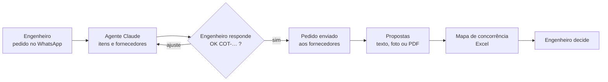

# agente-compras-whatsapp

Assistente de compras no WhatsApp: o engenheiro pede o material por texto, o agente escolhe fornecedores, pede orçamento e entrega um **mapa de concorrência em Excel**, com OK humano antes de qualquer envio.

> A versão com agente (v2) foi desenhada para não enviar nada a fornecedor sem o OK do engenheiro: a regra está no prompt, o roteador grava a aprovação quando o engenheiro responde `OK COT-…`, e há uma trava em código de exemplo (`travas/`). O serviço do agente, que aplicaria a trava, não está neste repositório (só o desenho).

> Reescrita didática, baseada na arquitetura de um sistema de compras de uma construtora; **não é o código de produção**. Empresa, obras, pessoas, fornecedores, telefones e valores deste repositório são **fictícios** (Construtora Exemplo, Residencial Aurora, Fornecedor Alfa Ltda…). Não há dado, credencial nem endereço reais.

## Problema

Em obra, o pedido de material chega por WhatsApp, escrito do jeito de quem está no canteiro: gíria, marca, embalagem ("balde", "rolo"), quantidade solta. Quem compra digita de novo numa planilha, chama fornecedor um a um e depois compara propostas que vêm em formatos diferentes (texto, foto de orçamento no papel, PDF). Nessa comparação, o item que um fornecedor esqueceu de cotar some dentro do total, e o "mais barato" nem sempre cobre o mesmo escopo.

## Solução

1. O engenheiro manda o pedido em texto livre. O agente extrai os itens **com as palavras dele** (marca, jargão, embalagem) e não confunde "3 opções de chuveiro" com 3 chuveiros.
2. Escolhe fornecedores **homologados**, por categoria e região de atendimento (com cidade e DDD como pista quando a região não está cadastrada).
3. Manda ao engenheiro um resumo do que entendeu e dos fornecedores. No desenho, **só depois do `OK COT-…` dele** o pedido é enviado, com 60 s entre um fornecedor e outro. O roteador v2 já grava o OK em `aprovacao`; quem barra o envio hoje é a regra do prompt, que confere essa tabela, porque o serviço do agente com a trava em código não está aqui (veja [docs/aprovacao-humana-e-travas.md](docs/aprovacao-humana-e-travas.md)).
4. Lê cada resposta (texto, foto ou PDF), separa **proposta** de **dúvida**, casa cada item ofertado com o item pedido e avisa o fornecedor do que ficou sem preço ou fora do pedido. Dúvida vai para o engenheiro e a resposta volta ao fornecedor.
5. A cada proposta, gera o **mapa de concorrência** (Excel, fórmulas vivas, menor preço destacado) e manda ao engenheiro. Quem deixou item sem preço não ganha o "menor total" por omissão.
6. Nunca fecha compra nem aprova valor. Organiza, equaliza e alerta.

O comportamento do agente (itens 1, 2 e 4) está definido nos prompts e não foi executado de ponta a ponta neste repositório. O que foi testado: gerador do mapa, trava, SQL, importação dos fluxos, roteadores e o código dos nós (veja Resultado).

## Diagrama



Fluxograma completo, diagrama de sequência e modelo de dados: [docs/arquitetura.md](docs/arquitetura.md). Como a aprovação é garantida em código: [docs/aprovacao-humana-e-travas.md](docs/aprovacao-humana-e-travas.md). Uma conversa de ponta a ponta: [exemplos/conversa-exemplo.md](exemplos/conversa-exemplo.md).

## Stack

| | |
|---|---|
| Orquestração | n8n (webhook, roteamento, dedupe, sessões) |
| WhatsApp | WAHA (API HTTP sobre o WhatsApp Web) |
| Agente | Claude (Anthropic) pelo Claude Agent SDK, num serviço Node à parte; ferramentas por papel, no padrão MCP |
| Dados | PostgreSQL 15 |
| Mapa | Python 3 + openpyxl |
| Travas | JavaScript (`canUseTool` do SDK), testes com `node --test` |
| Fluxos v1 | Groq (modelo aberto) só para extrair JSON de itens e de propostas |
| Infra | Docker |

Não usa RAG, LangChain nem fine-tuning.

## Resultado

O que **medi neste repositório** (e como):

| O quê | Resultado | Como medi |
|---|---|---|
| Fluxos n8n | 8 fluxos, 97 nós | contagem dos `nodes` de cada JSON |
| Importação | os 8 importam sem erro | os comandos do passo 4 (`docker cp` + `n8n import:workflow`) numa instância descartável (`n8nio/n8n`, n8n 2.32.5) |
| Roteadores rodando | repetição de mensagem, número desconhecido e `OK COT-…` se comportam como descrito | numa cópia de teste de cada roteador, com gatilho manual no lugar do webhook e os subfluxos trocados por nós que só marcam o ramo, executada com `n8n execute` (n8n 2.32.5 + Postgres 15 descartáveis). O mesmo `id_msg_waha` enviado duas vezes para no `Barrar Repetida` (v1 e v2); número fora do cadastro para na identificação (v1 e v2); no v1, engenheiro com dúvida aberta segue para `Pacote Resposta`, sem dúvida para `Pacote Nova Cotacao`, e fornecedor para `Pacote Proposta`; no v2, `OK COT-…` do engenheiro dono, em rascunho, grava 1 linha em `aprovacao` (também com minúsculas e espaços nas pontas); o de outro engenheiro, o de fornecedor e o com texto a mais não gravam; fora a mensagem repetida, todas seguem para o agente |
| SQL dos fluxos | 31 consultas válidas, todas sem precisar declarar o tipo dos parâmetros | `PREPARE` de cada consulta no Postgres 15 com o `schema.sql`; caminho feliz (log e dedupe → papel pelo número → cotação → itens → convites → proposta e reenvio → mapa → dúvida e resposta → aprovação → sessão → views) executado; `schema.sql` e `seed-exemplo.sql` rodados duas vezes sem erro |
| Código dos nós | 15 nós Code com JavaScript válido e comportamento conferido | cada `jsCode` carregado pelo Node dentro de uma função e executado com entradas simuladas (mensagens de grupo e próprias descartadas, casamento de itens, divergências, legenda, corpo do mapa, nome do anexo, prompt, retorno do agente); o nó que monta o corpo do mapa alimentou o `gera_mapa.py` e saiu a planilha esperada |
| Mapa de concorrência | 22 testes passando (gerador, fórmulas, regras de menor preço, imposto incluso ou negado, frete e desconto, avisos, resumo de negociação e servidor HTTP, inclusive `HOST` e `PORT` vazios) | `python -m unittest` (openpyxl 3.1.5, Python 3.12) |
| Fórmulas do Excel | totais conferem: R$ 3.336,60 / 3.535,40 / 2.800,00 | avaliador do teste e, de forma independente, a biblioteca `formulas` num venv à parte |
| Travas | 15 testes passando | `node --test` (Node 24) |
| Testes que pegam defeito | 22 quebras de propósito no gerador e no servidor, todas reprovadas; 14 no guarda, 13 reprovadas (a que sobreviveu é equivalente: o `arquivoAnexo &&` é redundante com o `try/catch` de `mesmoArquivo`) | numa cópia, troquei `min` por `max`, `MIN(` por `MAX(`, tirei a conta do unitário, a ordenação por `seq`, o limite de 5 MB, a rota `/health`, a negação e o acento de `imposto_incluso`, a modalidade "Não informado" do frete, o `HOST`/`PORT` vazio, o `startsWith`, a conferência de aprovação, a âncora inicial do `OK COT-…`, o número normalizado no envio etc. e rodei os testes |

Os scripts dessas verificações (PREPARE, execução dos roteadores, nós Code, quebras de propósito) foram feitos à parte e não estão neste repositório; as linhas de testes automatizados (22 e 15) são as únicas que se repetem com os comandos de Como rodar.

## Como rodar

Comandos em bash; os passos 2 a 5 partem da **raiz do repositório**. No Git Bash do Windows, rode `export MSYS_NO_PATHCONV=1` uma vez antes dos passos 3 e 4: sem isso o Git Bash reescreve caminhos como `/tmp/sql` e o comando falha. No PowerShell, troque o `\` do fim de linha pela crase (`` ` ``) ou escreva cada comando numa linha só (vale para o `docker run` do passo 3 e para o `curl` do passo 1), troque `source .venv/bin/activate` por `.venv\Scripts\Activate.ps1` e `curl` por `curl.exe`. Os demais comandos de `docker` funcionam como estão.

Tudo abaixo foi testado, exceto o que está marcado como "precisa do seu ambiente".

### 1. Mapa de concorrência (testado com Python 3.12)

```bash
cd mapa-concorrencia
python -m venv .venv
source .venv/bin/activate          # Git Bash no Windows: source .venv/Scripts/activate
                                   # cmd/PowerShell: .venv\Scripts\activate
pip install "openpyxl>=3.1,<4"      # testado com 3.1.5
python gera_mapa.py exemplo-entrada.json saida.xlsx
python -m unittest -v
```

`saida.xlsx` fica igual ao `exemplo-saida.xlsx` (a data de criação do arquivo muda). Para o nó "Chamar Gerador do Mapa" do n8n há um servidor HTTP mínimo:

```bash
python servidor_http.py            # http://127.0.0.1:5000 (HOST e PORT mudam o endereço; vazios valem o padrão); Ctrl+C encerra
```

Em outro terminal, na mesma pasta:

```bash
curl -s -X POST -H "Content-Type: application/json" --data-binary @exemplo-entrada.json \
     http://127.0.0.1:5000/gerar-mapa -o saida.xlsx
```

Quando terminar, volte à raiz do repositório (`cd ..`) para os próximos passos.

### 2. Travas (testado com Node 24, sem dependências)

Na raiz do repositório:

```bash
node --test
```

### 3. Banco de dados

Na raiz do repositório. Troque `<rede-do-seu-n8n>` pela rede Docker onde roda o seu n8n (`docker network ls`), para o nó do n8n alcançar o banco pelo nome `compras-pg`:

```bash
docker run -d --name compras-pg --network <rede-do-seu-n8n> \
  -e POSTGRES_PASSWORD=troque-esta-senha -e POSTGRES_DB=compras_db postgres:15-alpine
until docker exec compras-pg pg_isready -h 127.0.0.1 -U postgres; do sleep 1; done
docker cp sql/. compras-pg:/tmp/sql
docker exec compras-pg psql -U postgres -d compras_db -v ON_ERROR_STOP=1 -f /tmp/sql/schema.sql
docker exec compras-pg psql -U postgres -d compras_db -v ON_ERROR_STOP=1 -f /tmp/sql/seed-exemplo.sql
```

O `-h 127.0.0.1` evita um falso "pronto": na primeira subida a imagem roda um servidor temporário que só atende pelo socket interno. No PowerShell, troque a linha do `until` por `do { Start-Sleep 1; docker exec compras-pg pg_isready -h 127.0.0.1 -U postgres | Out-Null } until ($LASTEXITCODE -eq 0)`.

Os dois arquivos podem rodar de novo sem quebrar. O `seed-exemplo.sql` traz 2 engenheiros e 4 fornecedores fictícios (um deles desomologado, para a regra "só homologado"). Os telefones e `conversa_id` do seed são inventados, mas têm formato de número brasileiro: **antes de ligar uma sessão real do WAHA, troque-os pelos seus números de teste**, senão o agente tenta escrever para esses números.

### 4. Fluxos no n8n

Na raiz do repositório, dentro do container do seu n8n (ajuste o nome do container):

```bash
docker exec -u root compose-n8n-1 rm -rf /tmp/fluxos     # como root: o docker cp cria os arquivos como root; sem apagar, uma 2ª execução copia para /tmp/fluxos/n8n/ e o import lê os arquivos velhos
docker cp n8n compose-n8n-1:/tmp/fluxos
docker exec compose-n8n-1 n8n import:workflow --separate --input=/tmp/fluxos/v1-fluxos-deterministicos
docker exec compose-n8n-1 n8n import:workflow --separate --input=/tmp/fluxos/v2-agente
```

Eu testei a importação com estes mesmos comandos, num container descartável. Pela interface (Import from File) deve funcionar igual, mas não testei. Depois, **precisa do seu ambiente**:

1. Crie as 3 credenciais e escolha-as em cada nó que usa credencial (Postgres e HTTP Request com WAHA ou Groq; o n8n avisa nos nós sem credencial). Todo `credentials.id` vem como `REPLACE_ME_CREDENTIAL`; nos JSON são 31 nós Postgres, 15 com a chave do WAHA e 3 com a da Groq (contagem por `grep`/script sobre `n8n/`):

   | Nome no fluxo | Tipo | Valor |
   |---|---|---|
   | Postgres compras_db | Postgres | host `compras-pg`, porta 5432, banco `compras_db`, usuário `postgres`, senha `troque-esta-senha` (a do passo 3) |
   | WAHA - Chave (Header Auth) | Header Auth | cabeçalho `X-Api-Key` com a chave do seu WAHA |
   | Groq - Chave (Bearer Auth) | Bearer Auth | chave da Groq (só os fluxos v1 usam) |

   O `.env.example` é só referência: a chave do WAHA, a da Groq e a senha do Postgres entram pelas **credenciais do n8n** (tabela acima), não por variável de ambiente. Neste repositório só `HOST` e `PORT` são lidas por código (`servidor_http.py`); as outras são para o seu docker-compose e para o serviço do agente.

2. Sessão do WAHA: os fluxos usam a sessão `compras`. Aponte o webhook do WAHA para `/webhook/whatsapp-entrada` (v1) ou `/webhook/whatsapp-entrada-agente` (v2) do seu n8n. Use **um** roteador ativo por vez.
3. Endereços: as URLs dos nós HTTP são **fixas, escritas dentro dos nós**: `http://waha:3000` (12 nós), `http://agente-service:5100` (1 nó, só no v2) e `http://mapa-service:5000` (1 nó, o do mapa). São nomes de serviço de um docker-compose. **Nenhuma variável do `.env` as altera**, nem `WAHA_URL`, que é só referência: se os seus serviços tiverem outro nome ou porta, troque a URL em cada um desses nós (ou use um alias de rede com esses nomes).
4. Os `workflowId` dos nós "Chamar …" já apontam para ids legíveis (`compras-v1-nova-cotacao` etc.). Com a importação pela CLI isso casa sozinho; pela interface, abra cada nó "Chamar …" e escolha o fluxo na lista. Os sub-workflows precisam estar ativos (publicados) antes do roteador.
5. Rodar só um dos dois fluxos `04-…`: fazem a mesma tarefa (resolver o `@lid` do fornecedor), em intervalos diferentes.

### 5. Fluxo v2 (agente)

Na raiz do repositório. O prompt do agente fica dentro do nó "Compor Prompt", porque o nó Code do n8n não lê arquivo. Se mexer em `prompts/`, reembuta:

```bash
python n8n/embute_prompts.py           # reescreve n8n/v2-agente/01-agente-compras.json
python n8n/embute_prompts.py --check   # só confere (sai com 1 se estiver desatualizado)
```

**Anexos em foto e PDF.** O nó "Gravar na Pasta Compartilhada" grava o anexo em `/files/whatsapp-uploads/<id da mensagem>.<extensão>`, e o prompt manda o agente ler `/shared/whatsapp-uploads/<id da mensagem>.<extensão>`: é a mesma pasta, vista de dois containers. O seu ambiente precisa de duas coisas para isso funcionar:

1. **Volume.** A mesma pasta do host montada em `/files` no container do n8n e em `/shared` no `agente-service`, com a subpasta `whatsapp-uploads` criada e gravável pelo usuário `node` (uid 1000) do n8n.
2. **Variável.** `N8N_RESTRICT_FILE_ACCESS_TO=/files` no container do n8n. Sem ela o n8n recusa a escrita com `Access to the file is not allowed.`; sem a subpasta o erro é `ENOENT ... realpath '/files/whatsapp-uploads'`. Em qualquer dos dois casos nenhuma proposta em foto ou PDF chega ao agente.

```yaml
# trecho do docker-compose (exemplo; ajuste nomes e caminhos)
services:
  n8n:
    environment:
      N8N_RESTRICT_FILE_ACCESS_TO: /files
    volumes:
      - ./compartilhado:/files
  agente-service:
    volumes:
      - ./compartilhado:/shared
```

```bash
mkdir -p compartilhado/whatsapp-uploads && sudo chown -R 1000:1000 compartilhado   # uid do usuário node
```

A pasta `compartilhado/` guarda os anexos reais dos fornecedores e já está no `.gitignore`: não a versione.

O roteador v2 já grava a aprovação em `aprovacao` quando o engenheiro responde `OK COT-…` (testei isso no n8n, com um Postgres local). O que **falta** é o outro lado: o **serviço do agente** (`agente-service`, Node + Claude Agent SDK) não está neste repositório, então nada aqui barra o envio em código. Até ele existir, quem confere a tabela antes de enviar é o prompt. O contrato HTTP está em [docs/arquitetura.md](docs/arquitetura.md) e a trava que ele deve usar está em `travas/guarda.mjs`. Para usar a trava, o serviço precisa expor as ferramentas da lista do guarda, e o prompt do engenheiro precisa citar essas mesmas ferramentas (hoje ele descreve as do sistema original; veja [docs/aprovacao-humana-e-travas.md](docs/aprovacao-humana-e-travas.md)). Precisa de `ANTHROPIC_API_KEY` (veja o `.env.example`). Eu **não** executei os fluxos de ponta a ponta com WAHA, Groq e Claude de verdade.

## Estrutura de pastas

```
agente-compras-whatsapp/
├── README.md
├── LICENSE
├── .env.example
├── .gitignore
├── docs/
│   ├── arquitetura.md                  fluxograma, sequência, modelo de dados, contrato do serviço
│   └── aprovacao-humana-e-travas.md    aprovação em código, armadilhas de permissão, guarda
├── prompts/
│   ├── agente-compras.md               prompt do modo engenheiro
│   ├── agente-compras-fornecedor.md    prompt do modo fornecedor (sem Bash)
│   └── regras-de-equalizacao.md        como ler, casar e comparar propostas
├── n8n/
│   ├── v1-fluxos-deterministicos/      roteador, nova cotação, receber proposta, responder pergunta, 2x resolver LID
│   ├── v2-agente/                      roteador do agente e o fluxo que chama o serviço do Claude
│   └── embute_prompts.py               copia prompts/*.md para dentro do fluxo v2
├── mapa-concorrencia/
│   ├── gera_mapa.py                    gerador do Excel
│   ├── servidor_http.py                embrulho HTTP para o nó "Chamar Gerador do Mapa"
│   ├── test_gera_mapa.py               testes
│   ├── exemplo-entrada.json            3 fornecedores, 4 itens, fictícios
│   └── exemplo-saida.xlsx              resultado do exemplo
├── travas/
│   ├── guarda.mjs                      canUseTool de exemplo + leitor do "OK COT-…"
│   └── guarda.test.mjs                 testes
├── sql/
│   ├── schema.sql                      tabelas e views
│   └── seed-exemplo.sql                dados fictícios
└── exemplos/
    └── conversa-exemplo.md             diálogo de ponta a ponta
```

## Decisões de projeto

- **n8n para o encanamento, agente em serviço à parte.** O n8n cuida de webhook, dedupe, whitelist e sessão (coisas que devem ser previsíveis). O agente decide o que é ambíguo (entender o pedido, ler proposta). Troca: duas peças para operar.
- **Papel pelo número, não pelo texto.** Quem é engenheiro e quem é fornecedor sai do cadastro, no roteador. Texto de fornecedor é gente de fora e deve entrar no agente como dado delimitado, nunca como instrução (o delimitador e o isolamento de `cwd` ficam no serviço do agente, que não está aqui; o nó "Compor Prompt" só concatena e o fluxo manda `cwd: '/shared'` para as duas personas).
- **Fornecedor sem shell.** O modo fornecedor tem 4 ferramentas presas ao `id_fornecedor` e ao `conversa_id` do roteador. O pior caso de uma injeção de prompt é bagunçar a própria proposta.
- **Aprovação em código (no desenho).** `enviar_cotacao` só passa com uma linha em `aprovacao` e com a cotação ainda em `rascunho`: a linha é gravada pelo roteador quando o engenheiro responde `OK COT-…`, e o envio passa a cotação para `aberta`, o que gasta a aprovação. O guarda (`travas/guarda.mjs`) e os nós do roteador que gravam estão aqui; o serviço que usa o guarda, não. Troca: o engenheiro escreve `OK COT-…` em vez de "pode seguir". Perco naturalidade, ganho uma frase que o código confere sem adivinhar.
- **Rascunho antes de convidar.** A cotação existe como `rascunho` para ter código a aprovar, mas não convida ninguém.
- **Mapa por script fixo, com teste.** Mesma entrada, mesma saída. Numa fase intermediária do sistema original o agente escrevia o Python a cada cotação: mais flexível, sem garantia de resultado igual.
- **Divergência avisa, nunca bloqueia.** Item sem preço ou fora do pedido volta ao fornecedor como pergunta, e a proposta é gravada do mesmo jeito. Reenvio substitui a anterior (`UNIQUE` por cotação e fornecedor).
- **Mapa parcial a cada proposta**, em vez de esperar todo mundo. O engenheiro vê o andamento, e o gerador mostra "itens sem cotação".
- **Totais honestos.** Imposto "incluso" (ou "incluído") não soma de novo; imposto à parte soma, e a negação desfaz o "incluso" ("não incluso", "não está incluso", "impostos não inclusos", "sem imposto" somam), com acento e caixa ignorados. O silêncio do fornecedor vira "Não informado", nunca "Incluso". Na dúvida o imposto soma: o erro cai para o lado que não esconde custo. O menor total geral só é destacado entre quem cotou todos os itens.
- **60 s entre envios** e dedupe por `id_msg_waha`: o WAHA usa o WhatsApp Web (não oficial) e reentrega webhook. O node Postgres do n8n devolve um item placeholder quando o `INSERT` não grava nada, então há um `Barrar Repetida` logo depois do log para o fluxo parar de fato.
- **Duas gerações no mesmo repositório.** A v1 (n8n + modelo de extração) fica como referência do desenho de dados e do que o agente substituiu.

## Limitações / o que ficou de fora

- **O serviço do agente não está aqui.** Há o contrato, os prompts e a trava, mas não o `agente-service` nem o servidor MCP in-process do modo fornecedor.
- **A v1 não tem aprovação humana.** Ela envia o pedido assim que extrai os itens. A aprovação existe na v2.
- **A trava em código é um desenho, não está ligada.** O roteador v2 grava a aprovação, mas o serviço do agente não está aqui, e o prompt do engenheiro descreve as ferramentas do sistema original, não a lista do `guarda.mjs`. Na versão que rodou, a confirmação do modo engenheiro era regra de prompt. O `guarda.mjs` é o desenho para trocar isso por código; foi escrito para este repositório e não é o código de produção. Mesmo ligada, a aprovação vale para um envio só, mas não fica presa ao conteúdo: editar o rascunho depois do `OK` não a invalida (veja [docs/aprovacao-humana-e-travas.md](docs/aprovacao-humana-e-travas.md)).
- **Não executei os fluxos de ponta a ponta.** Testei importação, SQL, código dos nós, gerador, servidor HTTP e travas. Faltou WhatsApp, Groq e Claude de verdade (por não chamar API paga ou externa nos testes).
- **O Excel não foi aberto no Excel.** Conferi estrutura com openpyxl e fórmulas com dois avaliadores, não a aparência. Além disso, o `exemplo-saida.xlsx` não traz valores calculados em cache (o openpyxl só grava a fórmula): Excel e Google Sheets calculam ao abrir, mas visualizadores que não recalculam mostram os totais vazios. Os totais esperados estão na tabela de Resultado.
- **Cadastro de fornecedores simplificado.** No sistema real ele vivia em outro sistema interno, lido por MCP; aqui é uma tabela. Categorias e regiões são uma lista enxuta.
- **Sem conversão automática de embalagem.** Saco de 25 kg contra 50 kg é registrado como premissa e vira pergunta; o agente não converte por conta própria.
- **WhatsApp não oficial.** Há risco de bloqueio do número. Para uso sério, avaliar a API oficial do WhatsApp Business.
- **Credenciais e ids são placeholders; as URLs dos nós HTTP são fixas.** Os endereços `http://waha:3000`, `http://agente-service:5100` e `http://mapa-service:5000` estão escritos nos nós e não vêm do `.env` (passo 4, item 3). Os fluxos seguem o desenho do sistema original, mas foram reescritos para este repositório: sessão, ids, tabelas, colunas, nós, variáveis e textos são outros, e os ids dos nós foram gerados do zero. Diferenças de comportamento em relação ao desenho original: o nó "Chamar Gerador do Mapa" aponta para `servidor_http.py`; "Ler Precos Cotados" e "Montar Corpo do Mapa" mandam também o total do item; o roteador v2 foi derivado do v1 conforme o desenho (webhook, dedupe, filtro, identificação, chamada do agente) e ganhou os dois nós da aprovação (`Mensagem e um OK?` e `Registrar Aprovacao`); o roteador v1 ganhou o `Barrar Repetida`, porque sem ele uma mensagem repetida seguia adiante; o corpo da chamada ao serviço manda só `persona` e ids (o do modo engenheiro leva também `id_engenheiro` e `conversa_id`, que o guarda precisa), sem `fullAccess`; o prompt do engenheiro ganhou a tabela `aprovacao` (só leitura) e a regra de conferi-la antes de enviar; schema e prompts foram reescritos.

## Licença

MIT. Copyright (c) 2026 Rafael M. da Silva Santos. Veja [LICENSE](LICENSE).
